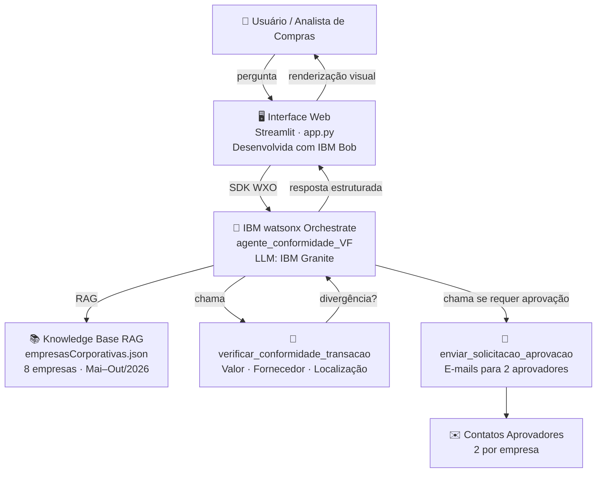

# Agente de Conformidade de Compras — VF (Versão Final)

> **IBM SkillsBuild AI Experiential Learning Lab for Brazil**
> Desenvolvido com IBM Bob · IBM watsonx Orchestrate · IBM Granite · Streamlit

Agente nativo do IBM watsonx Orchestrate especializado em **verificação de conformidade
de transações de compras**. Opera com knowledge base (RAG) para obter o histórico das
empresas e os contatos aprovadores. Inclui interface web (Streamlit) para interação via chat.

---

## Impacto de Negócio

| Métrica | Antes (manual) | Depois (automatizado) |
|---|---|---|
| Tempo de auditoria mensal (8 empresas) | ~5 horas | ~5 minutos |
| Acionamento dos aprovadores | 1–2 dias | Imediato |
| Cobertura de transações auditadas | Parcial | 100% |
| Escalabilidade | Linear | Constante |

**Stakeholder:** Ana Paula, Analista de Conformidade de Compras — responsável por auditar mensalmente as transações de 8 empresas e acionar os aprovadores designados por empresa.

---

## Como o IBM Bob foi usado

O IBM Bob foi o copiloto de engenharia central em todo o ciclo de desenvolvimento:

| Atividade | Contribuição do IBM Bob |
|---|---|
| **Arquitetura** | Identificou e reorganizou dois projetos misturados no repositório, eliminou duplicatas |
| **Frontend** | Criou integralmente o `app.py` — conexão WXO SDK, renderização HTML/CSS, secrets |
| **Depuração** | Diagnosticou URL errada da instância WXO, PATH do CLI, bugs de unicode no parser |
| **Segurança** | Criou `.gitignore`, `.env.example`, configurou secrets para Streamlit Cloud |
| **Documentação** | Redigiu README, declarações do desafio, diagrama de arquitetura |

> Todo o código e documentação deste repositório foi produzido em sessão colaborativa com IBM Bob.

---

## Responsabilidades

O agente verifica exclusivamente **3 critérios de conformidade** em cada transação:

| # | Critério | Dispara aprovação quando… |
|---|----------|--------------------------|
| 1 | **Valor > 15%** | O valor total da transação é mais de 15% acima da média histórica mensal da empresa |
| 2 | **Fornecedor novo** | O fornecedor da transação **não está** no histórico de compras da empresa |
| 3 | **Localização nova** | A localização da transação **não está** no histórico de localizações da empresa |

Se **qualquer um** dos critérios for verdadeiro, a solicitação de aprovação é enviada
automaticamente para os **2 contatos responsáveis** cadastrados na knowledge base.

---

## Arquitetura da Solução



---

## Estrutura do Projeto

```
Agente de Conformidade de Compra VF/
├── app.py                           # Interface web Streamlit (frontend)
├── agente_conformidade_VF.yaml      # Spec do agente nativo (WXO)
├── README.md                        # Este arquivo
├── requirements.txt                 # Dependências Python
├── workspace_config.yaml            # Configuração de pastas do workspace WXO
├── prompt_sistema.md                # Documentação do prompt/instruções do agente
├── exemplo_saida.md                 # Exemplo real de saída do agente
├── tools/
│   └── conformidade_vf_tools.py     # 2 ferramentas Python do agente
├── knowledge_base/
│   ├── conformidade_vf_kb.yaml      # Spec da knowledge base
│   └── docs/
│       └── empresas_corporativas.json  # Histórico + contatos das 8 empresas
└── tests/
    └── test_conformidade_vf.py      # 30 testes unitários (100% pass)
```

---

## Ferramentas

| Ferramenta | Descrição |
|------------|-----------|
| `verificar_conformidade_transacao` | Verifica os 3 critérios de conformidade e retorna divergências encontradas |
| `enviar_solicitacao_aprovacao_conformidade` | Gera e envia a solicitação formal para os 2 contatos aprovadores |

---

## Knowledge Base

A knowledge base `compras_conformidade_kb` contém o arquivo `empresas_corporativas.json`
com o histórico mensal de 8 empresas (Mai–Out/2026), incluindo:
- Valores totais mensais
- Localização de origem das compras
- Fornecedores utilizados por mês
- **Contatos aprovadores** (Administrativo + Pessoa de Confiança) por empresa

> Os contatos são obtidos **exclusivamente da knowledge base** — o agente nunca inventa
> dados de contato.

---

## Interface Web (Streamlit)

O arquivo `app.py` fornece uma interface de chat conectada ao agente no watsonx Orchestrate.

### 1. Instalar dependências

```powershell
pip install ibm-watsonx-orchestrate streamlit python-dotenv
```

### 2. Configurar credenciais

Copie o arquivo de exemplo e preencha com suas credenciais:

```powershell
Copy-Item .env.example .env
notepad .env
```

Conteúdo do `.env`:

```
ORCHESTRATE_URL=https://api.eu-de.watson-orchestrate.cloud.ibm.com/instances/1091e0d5-81f5-485a-8628-6e8b821e3bdf
ORCHESTRATE_API_KEY=<sua-ibm-cloud-api-key>
```

> A API Key é gerada em: https://cloud.ibm.com/iam/apikeys
> CRN da instância: `crn:v1:bluemix:public:watsonx-orchestrate:eu-de:a/72666b3953204b45a29eb70b2179106e:1091e0d5-81f5-485a-8628-6e8b821e3bdf::`

### 3. Adicionar e ativar o ambiente WXO

Só precisa fazer uma vez:

```powershell
orchestrate env add --name cloud --url "https://api.eu-de.watson-orchestrate.cloud.ibm.com/instances/1091e0d5-81f5-485a-8628-6e8b821e3bdf" --type ibm_iam --activate
```

> Se o CLI `orchestrate` não for reconhecido, adicione ao PATH:
> ```powershell
> $env:PATH += ";$env:APPDATA\Python\Python314\Scripts"
> ```

### 4. Importar agente (se ainda não existir no ambiente)

```powershell
orchestrate knowledge-bases import -f knowledge_base/conformidade_vf_kb.yaml
orchestrate tools import -k python -f tools/conformidade_vf_tools.py
orchestrate agents import -f agente_conformidade_VF.yaml
```

Para verificar se já existe antes de importar:

```powershell
orchestrate agents list
```

### 5. Executar o Streamlit

```powershell
cd "C:\...\Agente de Conformidade de Compra VF"
python -m streamlit run app.py
```

Acesse em: **http://localhost:8501**

### Funcionalidades

- Chat com o agente `agente_conformidade_VF` via IBM watsonx Orchestrate SDK
- Botões de atalho para ações comuns (verificar todas as empresas, checar fornecedores, localizações e valores)
- Visualização da knowledge base (empresas cadastradas)
- Exibição opcional da trilha de raciocínio do agente (Reasoning)
- Controle de sessão (thread_id) para conversas com contexto

---

## Deploy (WXO)

```bash
# 1. Ativar o ambiente WXO
orchestrate env activate <seu-ambiente>

# 2. Importar a knowledge base
orchestrate knowledge-bases import -f knowledge_base/conformidade_vf_kb.yaml

# 3. Importar as ferramentas
orchestrate tools import -k python -f tools/conformidade_vf_tools.py

# 4. Importar o agente
orchestrate agents import -f agente_conformidade_VF.yaml
```

---

## Testes

Execute os 30 testes unitários diretamente:

```bash
python -X utf8 tests/test_conformidade_vf.py
```

Resultado esperado: **30/30 ✅ PASS, 0 FAIL, 0 ERROR**

---

## Origem

Este agente foi derivado de:
- `agente_com_rag_2` — lógica RAG e ferramentas de auditoria completa
- `agente_sem_rag_2` — modo híbrido com dados embutidos

O `agente_conformidade_VF` é uma versão **focada e simplificada**, restrita aos 3
critérios de conformidade mais críticos para aprovação de compras.
